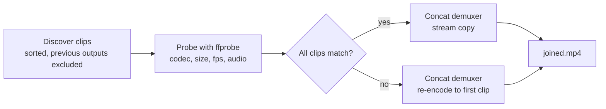

# Wyze Video Joiner

Wyze cameras save motion and continuous recording as lots of tiny clips. This joins them back into one watchable video — in order, without re-encoding when it doesn't have to.

## Why

- **One file per outing, not sixty.** A folder of 1-minute clips becomes a single video you can actually scrub through.
- **Lossless when clips match.** Identical clips are joined with ffmpeg's concat demuxer and stream copy: no quality loss, and much faster than re-encoding.
- **Mixed folders still work.** If clips differ in codec, size, or frame rate, it re-encodes to the first clip's layout instead of failing.
- **It won't eat its own output.** Previous outputs (`joined.mp4`, `joined-YYYY-MM-DD.mp4`) are never fed back in as inputs, and an existing output is never overwritten unless you pass `--force`.

## Non-goals

- Not a video editor: no trimming, cutting, or effects beyond joining.
- Not a Wyze downloader or cloud client: it works on clips you already have on disk.
- Not a transcoder: re-encoding is a fallback for mismatched clips, not the point.

## Prerequisites

- Python 3.10+
- ffmpeg and ffprobe on your PATH ([ffmpeg.org/download](https://ffmpeg.org/download.html)). The tool shells out to them; it does not bundle them.

## Quick start

```bash
pip install .
wyze-join /path/to/clips
# -> /path/to/clips/joined.mp4
```

Or with the GUI (needs the GUI extra):

```bash
pip install .[gui]
wyze-join-gui
```

## Usage

```bash
# Join a folder, in sorted filename order
wyze-join clips/

# Pick the output, and refuse to overwrite is the default
wyze-join clips/ --output afternoon.mp4
wyze-join clips/ --output afternoon.mp4 --force

# Search subfolders too (e.g. date/hour folders off an SD card)
wyze-join clips/ --recursive

# One file per recording date, from timestamped filenames
wyze-join clips/ --split-by-day

# Force the strategy instead of auto-detecting it
wyze-join clips/ --strategy copy      # refuse mismatched clips
wyze-join clips/ --strategy reencode  # always re-encode

# See the plan without writing anything
wyze-join clips/ --dry-run
```

The CLI prints the plan before joining, including a warning for any gap it finds: when filenames carry full timestamps, it compares each clip's start against the previous clip's end and reports uncovered time (over half a second). A gap is a warning, not a failure — the join still runs.

```text
3 clip(s) (copy) -> clips/joined.mp4
  20240101_120000.mp4  (60.0s, 1920x1080)
  20240101_120100.mp4  (60.0s, 1920x1080)
  20240101_120300.mp4  (60.0s, 1920x1080)
  Warning: 60.0s gap between 20240101_120100.mp4 and 20240101_120300.mp4
Wrote clips/joined.mp4
```

## How it works



Progress is parsed from ffmpeg's own progress output against the summed clip duration, so the bar reflects the actual encode/copy — the original version re-ran the whole join once per clip and counted runs as progress.

<details>
<summary>Layout</summary>

```text
src/wyze_joiner/
  core.py   # Qt-free discovery, probing, planning, joining (stdlib + ffmpeg)
  cli.py    # wyze-join entry point
  gui.py    # optional PyQt6 GUI (wyze-join-gui)
  gui_stylesheet.qss
  icon_title_bar.png
tests/
  test_core.py  # synthetic ffmpeg clips: order, copy, re-encode, gaps, split-by-day
  test_cli.py   # dry run, real run, missing folder
```

</details>

<details>
<summary>Development</summary>

```bash
pip install -e .[gui,dev]
pytest -q
ruff check . && ruff format --check .
mypy --strict src/wyze_joiner/core.py src/wyze_joiner/cli.py
```

The GUI is not covered by automated tests (it needs a display); the core and CLI are, against real ffmpeg output. CI runs the same gates on Python 3.12.

</details>

<details>
<summary>History</summary>

Originally a 2023 PyQt5 script (`main.py`, `gui_manager.py`, `wyze_video_manager.py`) using ffmpeg-python. The 1.0.0 modernization keeps that history and replaces the flat scripts with an installable package: a Qt-free core, a CLI, a PyQt6 GUI, stream-copy joining, sorted discovery, output exclusion and overwrite protection, gap warnings, and split-by-day output. The old script names are gone; install it and use `wyze-join` / `wyze-join-gui`.

</details>

## License

MIT — see [LICENSE](LICENSE).
